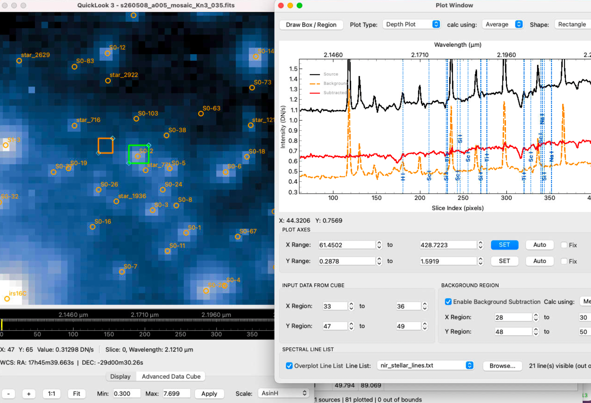
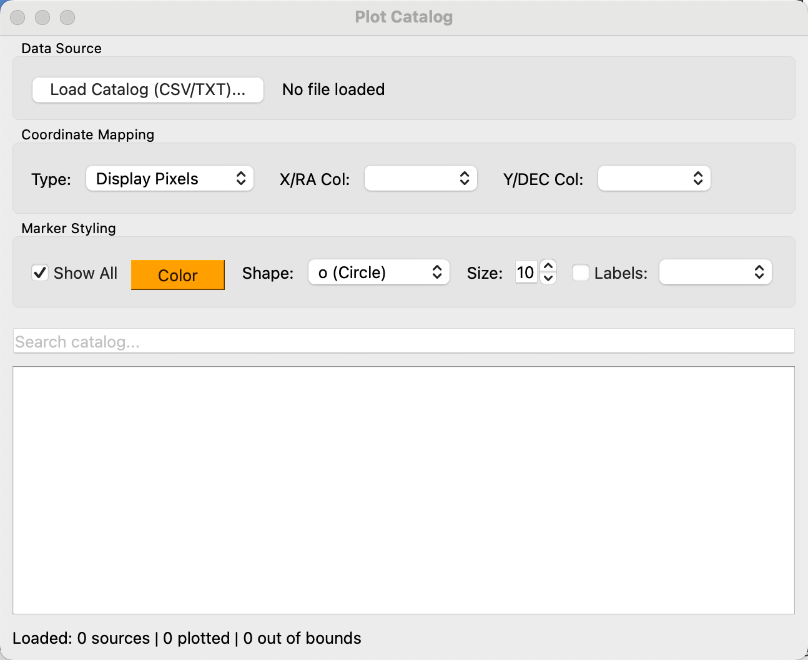

# Astronomical Tools & Algorithms Guide

QuickLook 3 provides a suite of analytical tools tailored for Integral Field Unit (IFU) data cubes and 2D astronomical images. This guide details the usage and mathematical algorithms underlying each tool.

---

## Data Units

Every unit label — the colorbar, the hover readout, the Depth Plot and the cut plots — names the unit the file's `BUNIT` keyword states: `DN/s` for OSIRIS (`'ADU per second per coadd'`), `MJy/sr` for a JWST cube. A unit written in a form astropy cannot read (`ELECTRONS/S`, `counts/s`) is shown in the file's own words. A file that states no unit, such as a Gemini NIFS cube, is labelled **Unknown**; the unit is never guessed from the values.

An extension whose header states no `BUNIT` takes the primary header's unit and integration time, as the OSIRIS noise extension (in DN/s) needs, unless its values are integers: those are flags, such as the OSIRIS quality extension or a JWST `DQ`, and have no unit. It never takes another extension's: a JWST `DQ`, `WMAP` or `VAR_*` extension is not in the `SCI` extension's MJy/sr, so it reads **Unknown** unless it states a unit of its own.

**Display ➔ Data Units** has two choices. **As Stored** shows the values as the file holds them, with the file's unit in parentheses: `As Stored (DN/s)`, `As Stored (MJy/sr)`, `As Stored (unit not stated)`. **As Total DN** multiplies a count rate by the integration time: `TRUITIME` (else `ITIME`) times `COADDS`, or `EXPTIME` when the header has neither. It is offered only when the data are a count per second (`DN/s`, `electron/s`, ...) and the header states an integration time; otherwise it is disabled and its tooltip gives the reason ("data are in MJy/sr", "no unit is stated for these data", "the file's unit 'counts/s' is not recognised", "no integration time in the header"). Loading such a file while Total DN is shown switches back, with the status bar message "Total DN is not available for this file (*reason*); showing the values as stored."

---

## 1. Depth Plot & Spectral Line Lists

The **Depth Plot** tool extracts 1D spectra along the wavelength ($Z$) axis of a 3D data cube.



### Algorithms

#### A. Spatial Region Spectrum Extraction
For a user-selected Region of Interest (ROI) containing spatial pixels $(x, y)$, the spectrum value $S(z)$ at wavelength channel $z$ is computed using one of three calculation methods:

* **Mean (Average)**:
  $$S(z) = \frac{1}{N} \sum_{(x,y) \in \text{ROI}} I(x, y, z)$$
* **Median**:
  $$S(z) = \text{median}_{(x,y) \in \text{ROI}} \left( I(x, y, z) \right)$$
* **Total (Sum)**:
  $$S(z) = \sum_{(x,y) \in \text{ROI}} I(x, y, z)$$

The tool opens on a **circular** aperture combined with **Total**. That is the combination
for which background subtraction has a single unambiguous definition (§B), and it is the
same quantity the Aperture Photometry tool reports for one plane.

Everything that defines what is measured is in the **EXTRACTION APERTURE** group: the shape,
how its pixels are combined, and its geometry in the form that shape is parameterised —
**Center X / Y** and **Radius** for a circle, **X Region / Y Region** for a rectangle. The
geometry controls swap with the shape rather than describing a circle by its bounding box.
**Center X / Y** are pixel indices, so a circle whose centre reads `12, 9` is drawn on the
centre of pixel (12, 9) and measures that pixel; the Aperture Photometry and Strehl tools
place their circles the same way.
The **BACKGROUND** group likewise shows only the controls its current mode uses. An annulus
is offered only for a circular aperture, since it has nothing to be concentric with
otherwise; selecting a rectangle withdraws the option rather than ignoring it.

For a circular aperture the pixels on the boundary are weighted by the fraction $w_i$ of
each pixel the circle covers, so $N = \sum_i w_i$ rather than a count of whole pixels. This
matters at the small radii typical of an IFU field: a 3 px aperture quantised to whole
pixels is wrong by several percent. A median cannot be weighted meaningfully, so the
**Median** method instead uses the whole pixels whose centres fall inside.

#### B. Background Subtraction
Background subtraction estimates one background level $b(z)$ per channel and removes it from
every pixel of the aperture before the pixels are combined. Two modes set where $b(z)$ is
measured:

* **Annulus** (default) — a sky annulus concentric with the extraction aperture, with inner
  radius $r_{\text{in}}$ and outer radius $r_{\text{out}}$. The annulus is *not* independent:
  its centre is the centre of the extraction circle and follows it whenever the aperture is
  moved or resized. This is aperture photometry applied channel by channel.
* **Region** — an independently placed and sized ROI, for a background that must be measured
  somewhere specific.

With $b(z)$ the level over the annulus (its **Median**, the default, or its **Average**) and
$A = \sum_i w_i$ the aperture area:

$$
S_{\text{subtracted}}(z) =
\begin{cases}
\sum_i w_i\, I_i(z) \;-\; b(z)\,A & \text{Total} \\[4pt]
\dfrac{\sum_i w_i\, I_i(z)}{A} \;-\; b(z) & \text{Average} \\[4pt]
\operatorname{median}_i I_i(z) \;-\; b(z) & \text{Median}
\end{cases}
$$

The **Total** line is the standard photometric estimator, $\text{aperture\_sum} -
\text{median(annulus)} \times \text{area}$; the other two are the same quantity expressed per
pixel. A background **Total** is offered only in Region mode: summing an annulus and then
subtracting that sum from each pixel would scale with however wide the annulus happened to
be drawn, so it is disabled for an annulus.

A NaN pixel contributes to neither $\sum_i w_i I_i$ nor $A$, so a masked or dead pixel inside
the aperture reduces the area rather than poisoning the channel. $A$ is therefore counted per
channel, in Region mode as in Annulus mode. A channel in which no aperture pixel is finite is
NaN for every combine method, Total included, and a channel that is entirely NaN within the
annulus yields a NaN background for that channel alone. Geometry that cannot be measured at
all — an aperture off the edge of the cube, $r_{\text{in}} \ge r_{\text{out}}$, a sky annulus
that starts inside the aperture ($r_{\text{in}} < r_{\text{ap}}$) — is reported beneath the
controls instead of being drawn as a flat line.

Because the aperture is circular and the view transforms are flips and multiples of 90°, the
extracted spectrum is invariant to how the image is currently oriented. Note that a circle in
pixel space is a circle on sky only for square spatial pixels, which OSIRIS has and some
instruments do not.

The arithmetic lives in `pyql3/core/spectral_photometry.py`, which imports no Qt and is
tested directly, including against the Aperture Photometry tool's independent implementation.

#### C. Wavelength Primary X-Axis & Dual Axis Display
When FITS WCS wavelength information is available, the primary bottom X-axis displays physical wavelengths $\lambda$ ($\mu\text{m}$), or, with a unit chosen in the **Cube wavelength unit** box under **Plot Axes** (below), the header's numbers in that unit. The top X-axis (`PixelIndexAxis`) dynamically renders the corresponding 0-indexed channel slice numbers ($z \in [0, N-1]$). 

This setup allows users to click the **Export...** button on the top control bar (or right-click the plot and select **Export...**) to save wavelength-resolved spectra ($xData = \lambda$, $yData = \text{Intensity}$) to CSV, vector graphics, or images.

Line list wavelengths $\lambda$ are mapped directly onto the plot in wavelength units. Overlays positioned outside the dataset's visible spectral range are automatically filtered out.
With **Log** X ticked, the lines, the cursor readout and the channel axis follow the logarithmic
axis.

A file that states no wavelength unit (a Gemini NIFS cube, for one) has its axis labelled
**Wavelength (Unknown)** in the header's own numbers, and the line list, which is in µm, cannot be
placed on it. The **Cube wavelength unit** box under **Plot Axes** states the unit of the cube's
numbers (not of the line list, which is always in µm): **Å**, **nm** or **µm**. The header's numbers are then shown as they are, labelled with the chosen unit and "set by
you" (for example **Wavelength (Å, set by you)**) on the plot, the cursor readout and the slice
readout under the image, and the line list is drawn. **From header** returns to the file's own unit,
which the entry names. The choice belongs to the window: it is kept when the next file is loaded,
so successive frames from one instrument keep it. A later file whose header states a unit replaces
it, unless the choice was made over that same stated unit (a correction of that instrument's
header); a file that states a different unit is shown in its own unit.

#### D. Spectral Line Overlay & Staggering
- Overlaid spectral line labels feature 90° vertical rotation.
- Labels stand up from a band along the **bottom** of the view, where a spectrum has its free
  space; the trace itself is pushed towards the top whenever autoranging also has to fit a
  background-subtracted curve near zero.
- To prevent overlapping labels when spectral lines are closely spaced, label heights are automatically staggered across 4 discrete vertical offset levels within that band.
- LaTeX mathematical expressions enclosed in `$$...$$` (e.g. `$$H_\alpha$$`, `$$P_{2f}6.5$$`) are automatically parsed and formatted.

Line lists are listed under their own filenames, so a curve can always be traced back to the
file it was drawn from. Hovering an entry shows the full path, which distinguishes copies of
the same filename coming from different data directories; each entry loads its own file.

A line list has one line per spectral line: the wavelength in µm, then the name, separated by a
comma or, on a line with no comma, by whitespace (`0.8027028,Ti I` or `0.8027028 Ti I`).
Lines starting with `#` or `;` are comments. A file in which no line can be read says so
beside the list ("No lines could be read from <file>").

#### E. Exporting Spectra & Figures (CSV, PNG, SVG)

Astronomers can export the extracted 1D spectra and plot graphics by clicking the **Export...** button on the top control bar (or right-clicking anywhere on the plot canvas and selecting **Export...**):

1. **Exporting Wavelength & Intensity Data to CSV**:
   - In the Export dialog, select **CSV Exporter** under **Item to export**.
   - Select the target curve (`PlotItem`, `Source`, `Background`, or `Subtracted`).
   - Click **Export** to save a `.csv` data table. When the cube's Z axis is spectral, the first column holds what the plot's bottom axis shows: wavelengths in $\mu\text{m}$ when the file states the axis's unit, or, when the axis reads "Wavelength (Unknown)" (a NIFS cube, for example), the header's own numbers, whose unit the file does not state; or, with a unit chosen in the **Cube wavelength unit** box, the header's numbers in that unit. Otherwise, as for a velocity axis, it holds the slice index. The subsequent columns contain the corresponding flux/intensity values, in the unit the plot's left axis names (see [Data Units](#data-units)).

2. **Exporting High-Resolution Images (PNG, JPG)**:
   - Select **Image Exporter** in the Export dialog.
   - Specify output image pixel dimensions ($W \times H$).
   - Click **Export** to save publication-quality plot figures.

3. **Exporting Vector Graphics (SVG)**:
   - Select **SVG Exporter** for vector graphics suitable for publication figures and vector editing software (e.g., Inkscape, Illustrator).

---

## 2. Spatial Profile Cuts

The **Cut Plot** tool extracts 1D spatial intensity profiles across slices of the image plane.

### Cut Types
* **Horizontal Cut**: A slice across a fixed $Y$ pixel coordinate range.
* **Vertical Cut**: A slice across a fixed $X$ pixel coordinate range.
* **Diagonal Cut**: An arbitrary linear cut defined by two endpoints $(x_0, y_0)$ and $(x_1, y_1)$.

### Algorithm
For multi-pixel cut widths, intensity values perpendicular to the cut vector are averaged or collapsed using Median, Mean, or Total sum.

A cut collapses one axis of the **EXTRACTION APERTURE**, so it measures the same figure the
Depth Plot does: with **Shape** set to *Circle*, pixels outside the circle are excluded rather
than the ROI's bounding box being taken whole. The **BACKGROUND** and **SPECTRAL LINE LIST**
groups have no meaning for a cut and are disabled, which the status line under the two groups
says in as many words.

---

## 3. 2D Peak & Line Fitting

The **Peak Fit** tool fits analytical 2D spatial surface models to stars, emission lines, or compact sources within a selected ROI.

The fit uses the whole pixels whose centres lie inside the box; it does not interpolate between pixels, so the result does not depend on where the box sits relative to the pixel grid. The part of a box that hangs off the image is left out, not counted as zeros, and a box that misses the image reports that instead of a fit. Center X and Center Y are pixel indices counted from 0, the same as the Depth Plot's aperture centre. Region Statistics reads pixels the same way.

### Mathematical Models

#### A. 2D Elliptical Gaussian
$$f(x, y) = z_0 + A \exp\left( -\left[ a (x - x_0)^2 + 2b (x - x_0)(y - y_0) + c (y - y_0)^2 \right] \right)$$

where:
$$a = \frac{\cos^2\theta}{2\sigma_x^2} + \frac{\sin^2\theta}{2\sigma_y^2}$$

$$b = \frac{\sin 2\theta}{4\sigma_x^2} - \frac{\sin 2\theta}{4\sigma_y^2}$$

$$c = \frac{\sin^2\theta}{2\sigma_x^2} + \frac{\cos^2\theta}{2\sigma_y^2}$$

The Full-Width at Half-Maximum (FWHM) along the two axes of the ellipse is given by:
$$\text{FWHM}_x = 2 \sqrt{2 \ln 2} \cdot \sigma_x \approx 2.35482 \cdot \sigma_x$$
$$\text{FWHM}_y = 2 \sqrt{2 \ln 2} \cdot \sigma_y \approx 2.35482 \cdot \sigma_y$$

All three models share one rotation, with $\theta$ the reported **Angle (deg)**:

$$x_{\text{rot}} = (x - x_0)\cos\theta + (y - y_0)\sin\theta, \qquad y_{\text{rot}} = -(x - x_0)\sin\theta + (y - y_0)\cos\theta$$

so the Gaussian above is $\exp\left(-\frac{x_{\text{rot}}^2}{2\sigma_x^2} - \frac{y_{\text{rot}}^2}{2\sigma_y^2}\right)$ written out. The
angle is measured counter-clockwise from the image's +X axis (the direction in which Center X
increases) toward +Y, in the image's own pixel axes, so a view rotation does not change it.
**FWHM X** is the width along the direction at that angle and **FWHM Y** the width perpendicular to
it; neither is necessarily the major axis. When FWHM Y is the larger, the major axis lies at the
angle plus 90°. An angle and the same angle ± 180° describe the same ellipse.

#### B. 2D Lorentzian
$$f(x, y) = z_0 + \frac{A}{1 + \left(\frac{x_{\text{rot}}}{\gamma_x}\right)^2 + \left(\frac{y_{\text{rot}}}{\gamma_y}\right)^2}$$

#### C. 2D Moffat Profile
$$f(x, y) = z_0 + A \left[ 1 + \left(\frac{x_{\text{rot}}}{\alpha_x}\right)^2 + \left(\frac{y_{\text{rot}}}{\alpha_y}\right)^2 \right]^{-\beta}$$

### Optimization
Fits are computed using non-linear Levenberg-Marquardt least-squares optimization (`scipy.optimize.curve_fit`).

---

## 4. Aperture Photometry

The **Aperture Photometry** tool computes integrated stellar fluxes and background sky noise.

### Algorithm
1. **Aperture Flux ($F_{\text{raw}}$)**: Sum of pixel intensities inside a circular aperture of radius $r_{\text{ap}}$. NaN pixels are left out of the sum.
2. **Sky Background ($I_{\text{sky}}$)**: Median of the finite pixel values inside an annular sky region between inner radius $r_{\text{in}}$ and outer radius $r_{\text{out}}$. Pixels of the annulus that fall off the image are not used. The inner radius must be smaller than the outer one; otherwise the tool shows a message instead of numbers.
3. **Net Subtracted Flux ($F_{\text{net}}$)**:
   $$F_{\text{net}} = F_{\text{raw}} - A \times I_{\text{sky}}$$
   where $A$ is the area of the aperture that overlaps finite data: $\pi r_{\text{ap}}^2$ for an aperture wholly on the image with no NaN pixels, and less at an edge or around a NaN pixel.

---

## 5. Strehl Ratio & Optical PSF Analysis

The **Strehl Ratio** tool evaluates Adaptive Optics (AO) performance by comparing the observed stellar Point Spread Function (PSF) against an ideal, diffraction-limited Airy pattern for a telescope of diameter $D$ at wavelength $\lambda$.

### Mathematical Model
The theoretical diffraction-limited Airy intensity pattern $I(\theta)$ is:

$$I(\theta) = I_0 \left( \frac{2 J_1(\pi D \theta / \lambda)}{\pi D \theta / \lambda} \right)^2$$

where $J_1(x)$ is the Bessel function of the first kind of order 1.

### Strehl Ratio Definition
$$\text{Strehl} = \frac{\left( \frac{I_{\text{peak}}}{F_{\text{total}}} \right)_{\text{observed}}}{\left( \frac{I_{\text{peak}}}{F_{\text{total}}} \right)_{\text{theoretical}}}$$

---

## 6. Datacube Arithmetic

The **Datacube Arithmetic** tool performs element-wise scalar or cube-to-cube mathematical operations ($+$, $-$, $\times$, $\div$) between open datasets:

$$D_{\text{result}}(x, y, z) = D_1(x, y, z) \odot D_2(x, y, z)$$

Image operands are converted to 64-bit floating point first, so a sum of integer frames does not wrap around, and the result is saved with `BITPIX = -64` and no `BZERO`/`BSCALE`. The result window is titled with the expression, for example `(a001.fits / a002.fits)`.

---

## 7. Catalog Plotting & World Coordinate Overlay

The **Plot Catalog** tool overlays external astronomical source catalogs directly onto the 2D image plane or collapsed datacube slices. Both text tables (CSV, TXT, DAT, ECSV, IPAC, ...) and FITS tables (`.fits`, `.fit`, `.fts`, and gzipped variants) are read.



### Input Formats

Text catalogs are parsed by `astropy.io.ascii` in guess mode, so most delimited or
fixed-width layouts load without configuration.

For a **FITS table**, any binary (`BINTABLE`) or ASCII (`TABLE`) extension can be used:

- When the file holds more than one table extension, the tool asks which one to read; a
  file with a single table loads without prompting. Tile-compressed image extensions are
  not offered, even though FITS stores them as binary tables.
- Columns holding one value *per row per element* — a spectrum column, for instance — are
  omitted, since a catalog overlay needs one scalar per source. The extension label next to
  the filename reports how many were skipped.
- Undefined (`TNULL`) and masked coordinates are counted as unusable in the status line
  rather than being plotted at the origin.
- Coordinate columns are guessed from the usual `photutils` and SExtractor spellings
  (`xcentroid`/`ycentroid`, `X_IMAGE`/`Y_IMAGE`, `ALPHA_J2000`/`DELTA_J2000`) and from
  VizieR's (`RAJ2000`/`DEJ2000`, `RA_ICRS`/`DE_ICRS`, `_RAJ2000`/`_DEJ2000`, `RAdeg`/`DEdeg`)
  in addition to plain `X`/`Y` and `RA`/`DEC`, and can always be overridden with the
  column selectors.

On the command line, `--catalog <file>` loads a catalog at startup and `--catalog-hdu
<index|EXTNAME>` selects the FITS extension non-interactively.

### Features & Coordinate Modes

Astronomers can select between three coordinate modes:

1. **World Coordinates (RA / DEC)**: Celestial Right Ascension ($\text{RA}$) and Declination ($\text{DEC}$) in degrees or sexagesimal notation.
2. **FITS Array Pixels**: raw FITS array pixel coordinates $(x_{\text{fits}}, y_{\text{fits}})$.
3. **Display Pixels**: Direct display viewport pixel coordinates.

For the two pixel modes, the **Origin** box beside the coordinate type says what the columns count
from: `0-based (array)` (the first pixel is 0, as photutils and the regions sent from the Region
menu write it) or `1-based (FITS)` (the centre of the first pixel is 1, as SExtractor's `*_IMAGE`
columns write it). It starts at 1-based when both chosen columns are `*_IMAGE` columns such as
`X_IMAGE`/`Y_IMAGE` or `XWIN_IMAGE`/`YWIN_IMAGE`, and at 0-based otherwise, and follows the columns
until you set it yourself. A choice made by hand is kept when a catalog with the same X and Y
columns is loaded again, and reset when the columns differ; regions sent from the Region menu are
always 0-based. World coordinates have no origin, and the box is hidden for them.

### Algorithms

#### A. WCS Celestial-to-Pixel Transformation
For catalogs specified in celestial World Coordinates $(\text{RA}, \text{DEC})$, celestial coordinates are converted to raw FITS pixel coordinates $(x_{\text{fits}}, y_{\text{fits}})$ using the dataset's 2D/3D FITS World Coordinate System:

$$(x_{\text{fits}}, y_{\text{fits}}) = \text{WCS}^{-1}(\text{RA}, \text{DEC})$$

The RA and Dec axes are identified from the WCS rather than assumed to be FITS axes 1 and 2, so
an image with Dec on axis 1 (an OSIRIS cube collapsed along wavelength) is handled. The whole
catalog is converted in one call, and the result is kept until the catalog, the coordinate
columns, the coordinate mode, the pixel origin or the image's WCS changes.

#### B. Display Rotation & Flip Mapping
To ensure source overlays track the image viewport when the astronomer rotates or flips the view, original FITS coordinates $(x_0, y_0)$ are mapped to current display coordinates $(x_{\text{disp}}, y_{\text{disp}})$ via the transformation algorithm:

1. **Horizontal Flip Adjustment**:
   If horizontal flipping is enabled:
   $$x_1 = N_x - 1 - x_0, \quad y_1 = y_0$$

2. **90° Rotation Iterations**:
   For $k = \frac{\theta}{90^\circ}$ orthogonal rotations:
   $$(x_{i+1}, y_{i+1}) = (N_{y,i} - 1 - y_i, \; x_i)$$

The markers, labels and selection highlight are re-placed whenever the displayed image changes: a
flip or 90° rotation, a new AXIS mapping, another extension, another file or a frame auto-loaded
by the poller. A catalog loaded before any image is plotted when the first image arrives. Labels
also follow a view rotation. *Display Pixels* are used as given and are not mapped.

#### C. Interactive Highlighting & Filtering
- **Interactive Source Selection**: Clicking any row in the catalog table highlights the target object on the image display with a target reticle ring, and recentres the view on it, also when the view is rotated. Changing a marker, label or unit control redraws the ring without moving the view; *Center on Source* in the row's context menu recentres on request.
- **Clearing a selection**: press **Escape** in the table, use the **Clear Selection** button beside the search box, or pick **Clear Selection** from the row's right-click menu. The view stays where it is. (Qt's own way out of a single-selection table is ctrl-clicking the selected row, which few people find.)
- **Search & Filter**: Real-time text search hides the table rows that do not match. It filters the table only; every source stays marked on the image.
- **Custom Marker Styling**: Supports customizable marker shapes (Circles, Squares, Triangles, Diamonds, Crosses), sizes, colors, and text labels.

---

## 8. FITS Header Editor

The **Header Editor** allows astronomers to view, search, add, or modify FITS header cards across all HDU extensions in memory. Changes can be saved back to a new FITS file.

Edits are kept in the editor, for each extension, until **Save Header**; switching the Extension
combo does not apply them, and **Cancel** discards all of them. Each row is written back to its own
card, so two cards with the same keyword stay separate, and a row that was not changed is not
written at all. COMMENT and HISTORY text can be edited too. An undefined value is shown empty and
stays undefined unless it is edited. Structural keywords (`SIMPLE`, `BITPIX`, `NAXISn`, ...) are not
changed, and neither are `BSCALE`, `BZERO` and `BLANK` of an integer image whose stored integers
QuickLook writes back. Saving the header keeps the data as stored on disk: integer images, scaled
or with a `BLANK` value, are written back as the same integers with their `BSCALE`, `BZERO` and
`BLANK`, and unsigned integers keep their `BZERO`; a tile-compressed image keeps its compression.
The exception is lossy tile compression (quantised floating-point images, or HCOMPRESS with a
scale): astropy compresses the data again on every save, so each save changes those pixel values
slightly (`BUGS.md` R92). If such a file changed on disk after it was opened, the save is refused and nothing is written:
reopen the file and make the change again. The edits then stay in the editor, unsaved, and are not
applied to the header in memory. Edits are checked before any is written, so an edit FITS does not
allow (a non-ASCII value, for example) is reported and none of the edits is applied.

---

## 9. Regions

Regions are annotations drawn over the image — **circles, boxes, arrows and text** — in the manner
of ds9. They can be saved and reloaded, exchanged with ds9 as `.reg` files, and handed to the
Catalog tool.

Everything lives under the **Region** menu; the same tools are available from a small vertical
toolbar (**Region ➔ Region Toolbar**, off by default and remembered once chosen) and from the
image's own right-click menu.

### Drawing

| Shape | How |
|-------|-----|
| Circle | drag out from the centre |
| Box | drag between opposite corners |
| Arrow | drag from tail to head |
| Text | click where the label goes; the label is asked for afterwards |

While a shape tool is armed, dragging on the image draws rather than pans. Press **Escape**, or click
the pressed toolbar button again, to stop drawing without drawing anything.

Right-clicking the image offers **New Region ➔ Circle / Box / Arrow / Text**, which places a
**default-sized** region on the pixel under the cursor without any dragging — usually quicker, since
the size is easy to change afterwards.

A region is moved by dragging it and resized from its handles. A **text** region has no separate
marker: the text itself is the handle, so click, drag or right-click the words.

### Editing

**Double-click a region** — or choose **Properties…** from its right-click menu, or from the Region
List — to open an editor for everything it carries: position and size, angle, label, colour, line
width, dashing, text size, tag, visibility, and a channel range.

The editor can stay open while you work on the image. Dragging or resizing the region updates the
position and size fields you have not typed in; **OK** and **Apply** write only the fields you
changed, and **Cancel** undoes what the editor applied but not a drag made on the image.

A **channel range** restricts a region to part of a cube, so a marker on an emission-line feature
appears only across the channels where the feature is. When the plane on screen combines several
channels, in **Collapse Region** mode or with a **Boxcar** wider than one, the region is shown if
its channel range overlaps those channels. On a 2-D image, which has no channels, it is always
shown. This has no equivalent in ds9 and is dropped when exporting a `.reg` file, which the export
report says.

**Region ➔ Region List…** shows every region in a table — type, position, size, angle, label, colour
and visibility — editable in place. Double-click the *Colour* cell for a colour picker, or the
*Type* cell for the full properties dialog. Right-click a row for **Properties…**, **Zoom To**,
**Colour…**, **Copy Coordinates** and **Delete** — *Zoom To* is the way to find one region in a
crowded field.

### Colours

Regions default to ds9's green. Note that this is the neon `#00ff00` ds9 draws, not the dark
`#008000` that Qt and the SVG palette call "green": colour *names* are kept in the model and in
saved files so they stay idiomatic, and are resolved to ds9's own RGB only for drawing.

### Labels in a crowded field

A region's `text` is drawn beside it. With a large catalogue that becomes a great deal of text, so:

- only labels inside the visible area are drawn — zoom in and more appear;
- labels are hidden while the view is panning and return once it settles;
- **Region ➔ Show Region Labels** turns them off entirely, as the Catalog tool's *Show Names* does.
  A **text** region is the region itself, not a label, so it stays on screen with labels off;
  above 500 regions, where the set is drawn as one overlay, it stays as its **+** marker.

### Saving, loading and ds9

| Action | Format |
|--------|--------|
| **Load Regions…** | either format — the file's *contents* decide, so a ds9 file named `.yml` still loads |
| **Save Regions As…** | QuickLook 3 YAML, unless the name ends in `.reg` |
| **Export ds9 Regions…** | ds9 `.reg`, whatever the name |

The native format is readable YAML that can be edited by hand:

```yaml
format: pyql3-regions/2
written_by: QuickLook 3 v3.0.19
style:
  color: green
  line_width: 2
  dash: false
  font_size: 12
regions:
- type: circle
  x: 31.5
  y: 9.5
  radius: 4.0
  text: src A
  z_range: [120, 180]
- type: box
  x: 20.0
  y: 30.0
  width: 6.0
  height: 4.0
  angle: 30.0
  color: red
  line_width: 3
  dash: true
```

Region files written by this version are format 2, which needs this version of QuickLook 3 or a
newer one to open; an older one says the file is from a newer version. Format 1 files from older
versions open here as before. To pass regions to an older version, or to anything else, export
them as ds9 `.reg` (**Region ➔ Export ds9 Regions…**), which opens anywhere.

The **`style:` block is ds9's `global` line**: it records the formatting the file was written with,
and each region writes only what it does differently — the box above is red and dashed, the circle
takes the file's green. Nothing about a region's appearance is left to whichever defaults the
program happens to have when the file is read, and editing the one block restyles every region that
did not override it. Saving regions loaded from such a file writes its `style:` block back.

Geometry is stored in **pixels**, and when the image has a WCS the sky position is recorded
alongside it — so the file holds every region in **both frames at once**, with `frame:` naming the
one that was meant:

```yaml
- type: circle
  x: 10.0
  y: 9.0
  radius: 3.0
  frame: sky          # ...or image, which is written out too rather than left implied
  sky:
    ra_deg: 266.4171407868465
    dec_deg: -29.00776633506410
    frame: fk5         # the frame of those two numbers: the image's own, by its ds9 name
    size_arcsec: 0.105
```

`frame: sky` means the same thing it does in ds9: the region is placed from its RA/Dec, so a set
drawn on one dither lands on the same stars in the next, and a box keeps its orientation on the sky
if the field is rotated. `frame: image` keeps the stored pixels instead, which is what something
fixed to the detector wants; each region is placed by its own `frame:`, and a re-save keeps it. That
holds for a region that also has a `sky:` block, which is what saving with a WCS writes; a
`frame: image` on a region with no `sky:` block is what any region saved without a WCS gets, and
it follows the sky once the file is saved with one. A region moved on an image with no WCS loses
its old sky position when it is saved, so the next load puts it where it was moved to. A region
kept on its pixels with `frame: image` also loses that setting when it is moved on an image with
no WCS, since the file then has no `sky:` block to keep it beside; set it again after the next save
with a WCS.

**Loading a file whose two frames disagree asks which to use** — that is, a file drawn on a
different pointing of the same field. The question is about the `frame: sky` regions only, names
the difference ("3 region(s) sit up to 20.4 pixel(s) apart in the two frames") and defaults to the
frame the file was saved with. It is
not asked when the two agree, which is every file loaded back onto the image it was drawn on: those
regions come back exactly where they were. `--regions` at startup never asks; it takes the frame
the file was saved with.

Anything that moved, and anything that could not be placed because this image has no WCS, is said
in the summary. A file saved with no WCS available has no sky positions to record and is always
read back in pixels.

ds9 export writes sky coordinates automatically when image coordinates would not line up — ds9's
`image` frame always means FITS axes 1 and 2, while an OSIRIS cube is displayed on axes 3 and 2.
Anything that cannot be carried across, in either direction, is listed in a summary rather than
dropped in silence.

On the way in, every frame ds9 writes is read: `image`, `physical`, and the sky frames `icrs`,
`fk5`/`j2000`, `fk4`/`b1950`, `galactic` and `ecliptic`, whether the frame is on a line of its own
or written into a statement (`fk5;circle(...)`), and a file without ds9's header line is recognised
too. A sky-frame file needs the image to have a
WCS covering the two axes on display — with one, positions in any of those frames land on the right
pixel, in decimal degrees or sexagesimal. `physical` is read as image coordinates: the two differ
only for a file cut out of a larger one with IRAF `LTV`/`LTM` keywords, and that shift is not
applied. Shapes QuickLook 3 does not draw — an ellipse, a compass, a ruler — are named in the
summary, so a file never loads short without saying why.

`--regions FILE` loads a region file at startup, in either format.

### Very large sets

Above 500 regions the whole set is drawn as a single overlay instead of one item each: 20,000
regions then load in about two seconds and 150 MB, against roughly two minutes and 1.2 GB. The
trade is that individual regions can no longer be dragged or right-clicked — they are still listed,
edited, saved and exported. The status bar says when this happens.

For a large set, **Region ➔ Send Regions to Plot Catalog…** copies them into the
[Catalog tool](#7-catalog-plotting-world-coordinate-overlay), which has a sortable table, a search
box and row highlighting. It is a copy taken at that moment, not a live link.
